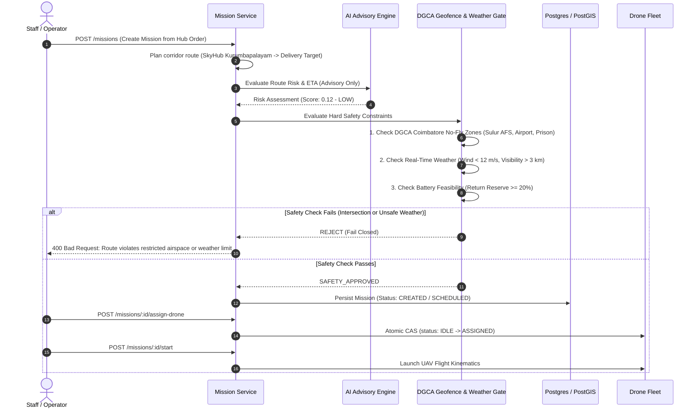
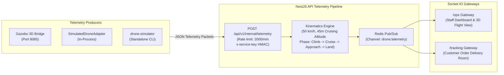
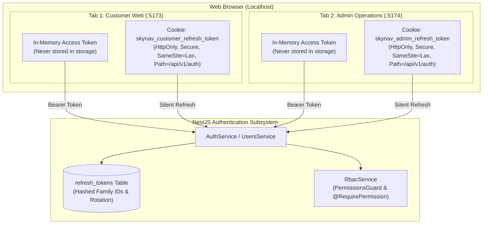

# SkyNav — System Architecture & Technical Specification

> **Simulation Disclosure**: All flight control, drone aerodynamics, computer vision obstacle detection, and landing zone evaluations in this repository run as **deterministic simulation models**. This system does not claim direct control of real physical UAV hardware or live in-flight machine learning models in production.

---

## 1. System Overview

SkyNav is a production-grade, full-stack autonomous drone delivery and airspace management platform. Built for reliable urban delivery operations, it powers autonomous package transit from **SkyHub Kurumbapalayam Base (`11.1132°N, 77.0277°E`)** to designated landing zones across Coimbatore, Tamil Nadu.

```mermaid
flowchart TD
    subgraph Clients["Frontend Applications"]
        CustWeb["Customer Web App\n(React 19 + Vite)\nPort 5173 / 3000"]
        AdminWeb["Admin Operations Console\n(React 18 + Vite)\nPort 5174 / 3001"]
    end

    subgraph API["Unified NestJS API Monolith (Port 4000)"]
        HTTPRouter["Express HTTP Router\n(/api/v1/*)"]
        WSOps["Socket.IO /ops Gateway\n(Staff Telemetry & Live Map)"]
        WSTrack["Socket.IO /tracking Gateway\n(Customer Delivery Tracking)"]

        subgraph CoreModules["Domain Modules"]
            AuthMod["Users, Auth & RBAC\n(In-Memory Tokens + Dual HttpOnly Cookies)"]
            CatalogMod["Catalog, Inventory & Hubs"]
            OrdersMod["Cart, Orders & Payments\n(Simulated Provider)"]
            MissionMod["Missions & Corridor Planner\n(Fail-Closed Safety Engine)"]
            TelemMod["Telemetry Ingest & Kinematics\n(50 km/h, 45m Altitude)"]
            SafetyMod["DGCA Geofences & Weather\n(Coimbatore Red/Yellow Zones)"]
            IntelMod["Simulation Intelligence\n(Vision, Swarm & Digital Twin)"]
        end
    end

    subgraph Sim["Simulation Ecosystem"]
        GazeboBridge["Gazebo 3D / ROS 2 Bridge\n(Port 8085, HMAC Auth)"]
        SimAdapter["SimulatedDroneAdapter\n(In-Process Kinematic Feeder)"]
    end

    subgraph DataTier["Data & Cache Tier"]
        Postgres[("PostgreSQL 16 + PostGIS\nPrisma ORM")]
        RedisCache[("Redis 7\nCache & Socket.IO Fan-out")]
        MinIOStore[("MinIO S3 Storage\nProof of Delivery Photos")]
    end

    CustWeb -->|In-Memory Bearer + Customer Cookie| HTTPRouter
    CustWeb -->|WebSocket /tracking| WSTrack
    AdminWeb -->|In-Memory Bearer + Admin Cookie| HTTPRouter
    AdminWeb -->|WebSocket /ops| WSOps

    HTTPRouter --> AuthMod
    HTTPRouter --> CatalogMod
    HTTPRouter --> OrdersMod
    HTTPRouter --> MissionMod
    HTTPRouter --> SafetyMod
    HTTPRouter --> IntelMod

    GazeboBridge -->|x-service-key| TelemMod
    SimAdapter --> TelemMod

    TelemMod --> RedisCache
    TelemMod --> WSOps
    TelemMod --> WSTrack

    AuthMod --> Postgres
    OrdersMod --> Postgres
    MissionMod --> Postgres
    SafetyMod --> Postgres
    HTTPRouter --> MinIOStore
```



---

## 2. Mission Safety Execution Pipeline

Every delivery flight strictly adheres to an authoritative deterministic safety pipeline:

```
Plan → Validate → Score → Safety Check → Authorize → Execute
```



### Safety Principles
1. **Advisory AI vs Authoritative Safety**: AI route scores and risk estimations are strictly advisory. No AI calculation may override geofence constraints, weather maximums, or minimum return battery reserves.
2. **Fail Closed**: Any network failure querying weather, airspace data, or battery status immediately halts mission dispatch.
3. **No Force Flags**: The legacy `force` dispatch bypass and hardcoded `D-001` override were permanently eliminated in Phase 1.

---

## 3. Real-Time Telemetry & WebSocket Architecture



- **Scoped Rate Limiting**: The internal telemetry ingestion route is protected by a dedicated high-capacity throttle (`2000/min`) distinct from the standard public user rate limit (`100/min`).
- **Room Isolation**: Customers subscribing to `/tracking` can only join the WebSocket room matching their specific order and delivery ID. Operational events are restricted to staff connected to `/ops`.

---

## 4. Authentication, RBAC & Session Isolation



### Session Hardening Details
1. **Isolated Refresh Cookies**: To prevent an admin login from logging out a customer session on `localhost` (a known flaw in the reference architecture), TARGET uses distinct cookie names:
   - `skynav_customer_refresh_token`
   - `skynav_admin_refresh_token`
2. **In-Memory Access Tokens**: Single Page Applications hold short-lived (15-minute) JWTs exclusively in JavaScript memory (`ApiClient` state). XSS cannot extract tokens from `localStorage` or `sessionStorage`.
3. **Rotating Refresh Tokens with Reuse Detection**: When a refresh token is exchanged, a new token is issued and the old token is invalidated. If an invalidated token is ever submitted, the entire token family is immediately revoked.
4. **Brute-Force Account Lockout**: Backed by Redis, soft-locking accounts after 10 failed login attempts within 15 minutes.

---

## 5. Domain Module Map

`apps/api/src/modules/` is organized into 18 bounded domain modules:

| Module | Core Responsibility |
|---|---|
| `users` | User registration, authentication, profile management, and password reset flows |
| `rbac` | Role-permission resolution matrix and `@RequirePermission()` guard |
| `audit` | Comprehensive audit trail for all staff, operator, and administrative mutations |
| `catalog` | Indian INR product catalog, categories, product variants, and specifications |
| `inventory` | Fulfillment hub inventory, stock allocation, reservations, and restock tracking |
| `cart` | Customer shopping cart and wishlist persistence |
| `orders` | Order state machine, lifecycle transitions, and customer invoices |
| `payments` | Simulated payment provider, webhook reconciliation, and refund handling |
| `delivery` | Delivery tracking lifecycle, SHA-256 hashed customer delivery OTP, and QR verification |
| `drones` | Fleet registry (40 UAVs at Kurumbapalayam hub), battery health, and maintenance |
| `missions` | Flight planning, corridor waypoints, mission engine, and operator overrides |
| `telemetry` | Kinematic telemetry ingestion, sample persistence, and live gateway fan-out |
| `realtime` | Socket.IO WebSocket gateways (`/tracking` for customers, `/ops` for staff) |
| `geofencing` | DGCA Coimbatore no-fly zones, red/yellow zone spatial polygons, and GIS checks |
| `weather` | Weather safety provider, wind speed, visibility thresholds, and storm holds |
| `ai` | Advisory ETA predictor, route feasibility scoring, and risk classification |
| `analytics` | Operational KPIs, delivery timings, cost per delivery, and drone utilization |
| `vision` | Simulated computer vision frame obstacle analysis and landing zone scoring |
| `swarm` | Autonomous fleet load balancing and regional cluster task allocation |
| `digital-twin` | Offline scenario simulation sandboxing isolated from live operational state |
| `route-intelligence` | Historical route performance, hazard heatmaps, and corridor efficiency |

---

## 6. Monorepo Directory Structure

```
D:\Drone-Automation-Delivery/
├── apps/
│   ├── admin-web/              # React 18 + Vite admin console (:5174 / :3001)
│   ├── api/                    # NestJS 11 unified backend API (:4000)
│   └── customer-web/           # React 19 + Vite customer store (:5173 / :3000)
├── packages/
│   ├── api-client/             # Universal API SDK with in-memory token management
│   ├── config/                 # Shared environment schemas and constants
│   └── shared-types/           # Shared Zod validation schemas and TypeScript types
├── services/
│   └── drone-simulator/        # Standalone kinematic drone simulator process
├── simulation/
│   └── gazebo/                 # Gazebo 3D simulation models, worlds, and bridge (:8085)
├── e2e/                        # Playwright end-to-end test suites
├── load-tests/                 # k6 load testing scripts
├── docs/                       # Architecture, security, setup, and deployment guides
├── docker-compose.yml          # Development infrastructure (Postgres, Redis, MinIO, Mailhog)
├── docker-compose.prod.yml     # Production container stack with strict env validation
├── turbo.json                  # Turborepo task pipeline configuration
├── pnpm-workspace.yaml         # Monorepo workspace package definitions
└── README.md                   # Project overview and quick start guide
```
