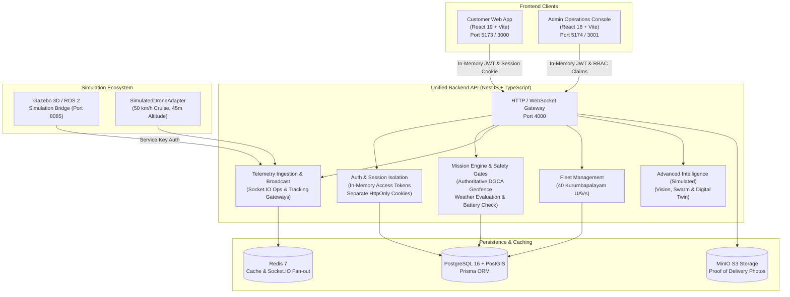

# SkyNav — Autonomous Drone Delivery Platform

> **Simulation Disclaimer**: All flight control, drone kinematics, computer vision obstacle detection, and landing zone evaluations in this repository run as **deterministic simulation models**. This system does not claim direct control of real physical UAV hardware or live in-flight machine learning models in production.

SkyNav is a production-grade, full-stack autonomous drone delivery and airspace management platform. Built for reliable urban delivery operations, it powers autonomous package transit from **SkyHub Kurumbapalayam Base (`11.1132°N, 77.0277°E`)** to designated landing zones across Coimbatore, Tamil Nadu.

---

## Architecture Overview



---

## Key Features

1. **Deterministic Safety Pipeline**:
   ```
   Plan → Validate → Score → Safety Check → Authorize → Execute
   ```
   Authoritative safety rules override all advisory AI outputs. Missions fail closed if routes intersect DGCA Coimbatore red/yellow restricted airspace, encounter unsafe weather, or lack required battery return reserves.
2. **True Cross-Tab Session Isolation**:
   Customer and Admin web applications maintain separate httpOnly refresh cookie names (`skynav_customer_refresh_token` vs `skynav_admin_refresh_token`). Admin operations in one tab never log out a customer in another on `localhost`.
3. **In-Memory JWT Access Tokens**:
   Zero storage of JWT access tokens in `localStorage` or `sessionStorage` (preventing token theft via XSS). Silent refresh operates via secured httpOnly cookies.
4. **Autonomous Kurumbapalayam Fleet**:
   40 autonomous drones (`D-001` through `D-040`) stationed at SkyHub Kurumbapalayam with real-time battery drain, waypoint tracking, and charging cycles.
5. **Gazebo & ROS 2 Telemetry Bridge**:
   Direct integration with Gazebo simulation on port 8085 authenticated via `x-service-key` headers.
6. **Advanced Simulation Intelligence**:
   - **Computer Vision**: Synthetic optical frame obstacle analysis and landing zone candidate detection.
   - **Landing Zone Evaluation**: Downward sensor suitability scoring (size, obstruction, proximity, safety).
   - **Swarm Balancing**: Fleet rebalancing algorithms across hub clusters.
   - **Digital Twin**: Offline what-if scenario sandboxing completely isolated from live flight control.

---

## Tech Stack

| Layer | Technologies |
|---|---|
| **Monorepo** | pnpm workspaces, Turborepo |
| **Backend** | NestJS 11, TypeScript 5.7, Express platform |
| **Database & ORM** | PostgreSQL 16 + PostGIS extension, Prisma ORM |
| **Caching & Realtime**| Redis 7, Socket.IO v4 with `@socket.io/redis-adapter` |
| **Object Storage** | MinIO (S3-compatible) with `@aws-sdk/client-s3` |
| **Frontends** | Customer Web (React 19 + Vite), Admin Web (React 18 + Vite, Three.js 3D canvas, Leaflet) |
| **Shared Packages** | `@skynav/shared-types` (Zod validation), `@skynav/api-client`, `@skynav/config` |
| **Testing** | Jest (unit & integration), Playwright (E2E), k6 (load testing) |
| **Security** | Argon2id password hashing, Helmet, Throttler rate limiting, Gitleaks, strict npm audit |

---

## Quick Start

### 1. Prerequisites
- Node.js 22+
- pnpm 11.9.0 (`corepack enable && corepack prepare pnpm@11.9.0 --activate`)
- Docker Desktop (for Postgres, Redis, MinIO)

### 2. Setup Environment
```bash
cp .env.example .env
```

### 3. Start Infrastructure
```bash
docker compose up -d
```

### 4. Migrate and Seed Database
```bash
pnpm db:migrate:deploy
pnpm db:seed
```

### 5. Launch Development Servers
```bash
pnpm dev
```
- **Unified API**: [http://localhost:4000](http://localhost:4000) (Health: `/health`)
- **Customer Web**: [http://localhost:5173](http://localhost:5173)
- **Admin Console**: [http://localhost:5174](http://localhost:5174)

### 6. Run Quality & Test Suite
```bash
pnpm typecheck   # Typecheck all 7 packages
pnpm lint        # ESLint across monorepo
pnpm test        # Run all 61 Jest test suites (430 unit tests)
npx tsx test_full_workflow.ts # Run full 16-step E2E integration test
```

---

## Seed Accounts

| Portal | Email | Password | Role |
|---|---|---|---|
| **Admin Console** | `admin@skynav.local` | `ChangeMe123!` | Super Administrator |
| **Customer Portal**| `customer@skynav.local`| `ChangeMe123!` | Customer |
